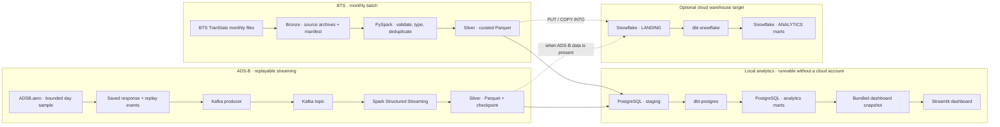

# FlightPulse | Aviation Data Engineering

**An end-to-end data platform for exploring US flight performance and aircraft trajectories.**
Demo: https://flightpulse-jvqs3gi87gnh4pbu2f2vtj.streamlit.app/

[](https://www.python.org/)
[](https://spark.apache.org/)
[](https://kafka.apache.org/)
[](https://www.postgresql.org/)
[](https://www.getdbt.com/)
[](https://www.snowflake.com/)
[](https://github.com/ibai71/flightpulse/actions/workflows/ci.yml)

## The problem

Flight delay data is useful only when it can be collected consistently, validated, and shaped into metrics people can interpret. FlightPulse brings monthly airline performance reports and aircraft trajectory observations through two reproducible pipelines, then presents the resulting analytics in one interactive dashboard.

## Data at a glance

| Source | Coverage in this snapshot | Role in the project |
| --- | --- | --- |
| [BTS TranStats: On-Time Performance](https://www.transtats.bts.gov/TableInfo.asp?QO_fu146_anzr=b0-gvzr&gnoyr_VQ=FGJ) | May–July 2026; 1,851,282 scheduled flight records across 13 reporting airlines and 354 airports | Batch analysis of arrival and departure punctuality, delays, cancellations, diversions, routes, and reported delay causes |
| [ADSB.aero historical API](https://adsb.aero/api/docs) | 40 flights selected around JFK on 7 October 2026; 2,114 timestamped observations after validation and deduplication | A bounded, replayable aircraft trajectory sample for the streaming pipeline |

The dashboard snapshot contains compact analytical aggregates for BTS and the ADS-B observation sample. It does not include the full BTS flight-level dataset. The ADS-B sample is an independent source: FlightPulse does not match those observations to BTS flight records.

The [architecture notes](docs/architecture.md) describe the pipeline steps and warehouse targets. Table grains and source-to-Silver field mappings are documented in the [data dictionary](docs/data_dictionary.md).

FlightPulse also includes an optional Snowflake warehouse path: validated Silver Parquet is loaded into Snowflake `LANDING`, and the shared dbt project builds the analytics models in `ANALYTICS`. This demonstrates a cloud warehouse target alongside the local PostgreSQL path. Snowflake credentials and a configured account are required to run that path; it is not required for the bundled dashboard demo. See the [Snowflake implementation notes](docs/snowflake.md).

## Architecture



The BTS flow preserves source archives in Bronze, quarantines invalid records, and writes typed, deduplicated flight legs to Silver. The ADS-B flow turns a saved API response into Kafka events, then processes one timestamped row per observation with a persistent Spark checkpoint. Both source domains feed the local PostgreSQL demo and can also be loaded into Snowflake; the sources are never joined to each other. The same dbt project builds facts, dimensions, and performance marts for both warehouse targets. The dashboard reads a small bundled snapshot, so it remains viewable without running either database.

## The dashboard

The Streamlit app in [`dashboard/app.py`](dashboard/app.py) reads the bundled snapshot and has five views:

- **Overview** — scheduled flights, on-time arrivals, average arrival delay, cancellations, and diversions, plus a daily punctuality trend.
- **Airports** — arrival or departure performance; search by city name or airport code, with all matching airports available in the table.
- **Airlines** — punctuality, average delay, cancellations, and diversions; search by carrier name or code.
- **Delay causes** — reported carrier, weather, airspace, security, and late-aircraft delay minutes.
- **ADS-B** — map of timestamped positions and separate altitude and ground-speed profiles for a selected sample track.

The page labels favor readable airport, airline, and aircraft names. The snapshot is stored under [`dashboard/data/snapshot/`](dashboard/data/snapshot/); the app needs neither a live database nor credentials to read it. Additional demo context and metric definitions are in [`dashboard/README.md`](dashboard/README.md) and [`docs/metrics.md`](docs/metrics.md).

To open the included dashboard locally, install its small set of UI dependencies and start Streamlit:

```powershell
python -m pip install -r dashboard/requirements.txt
python -m streamlit run dashboard/app.py
```

The command prints a local address to open in a browser. This dashboard uses the bundled snapshot; the data pipelines and Snowflake account are not needed to view it.

## Metric definitions

- **On-time arrival:** arrival delay below 15 minutes among flights that were not cancelled or diverted and have a known arrival delay. Early arrivals count as on time.
- **Cancellation and diversion rates:** cancelled or diverted records divided by all scheduled records.
- **Unknown values:** stay unknown; missing delays and causes are not converted to zero.
- **Delay causes:** BTS cause fields are reported independently, so their values are not assumed to sum to total delay.

## Engineering decisions

- **Stable flight grain:** one BTS-reported flight leg. Deduplication uses flight date, DOT reporting carrier ID, flight number, origin and destination IDs, and scheduled departure time.
- **Replayable streaming:** the archived ADS-B response can be replayed through Kafka; the Spark checkpoint supports recovery without relying on live API calls.
- **Data quality:** invalid BTS records are quarantined; Spark validations cover identifiers, types, coordinates, and plausible ranges. dbt tests cover model keys and relationships.
- **Repeatable CI:** pytest fixtures and a seeded PostgreSQL database let GitHub Actions exercise Python and dbt without calling BTS or ADSB.aero.

## Technology

| Area | Tools |
| --- | --- |
| Ingestion and runtime | Python, BTS TranStats, ADSB.aero, Docker Compose |
| Batch and streaming processing | PySpark, Spark Structured Streaming, Kafka |
| Storage and analytics | Parquet, PostgreSQL, Snowflake (optional target), dbt-postgres, dbt-snowflake |
| Data quality | pytest, Spark validation, dbt tests |
| User-facing analytics | Streamlit, Plotly |

## Project structure

```text
src/flightpulse/       BTS and ADS-B ingestion, Spark processing, Kafka streaming
dbt/models/            staging, facts, dimensions, and performance marts
dashboard/             Streamlit application and bundled analytics snapshot
scripts/               snapshot export and reproducible demo-data utilities
tests/                 fixture-based Python tests
docs/                  metric definitions and data dictionary
```

## Scope and limitations

The ADS-B pipeline demonstrates replayable streaming over a bounded historical sample; it is not a live air-traffic feed. BTS coverage in the bundled snapshot ends in July 2026, and the ADS-B sample is from one UTC day. The project does not predict delays, infer missing values, or link observations across the two sources.
