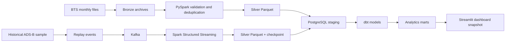

# FlightPulse | Aviation Data Engineering

**An end-to-end data platform for analyzing flight punctuality, delays, cancellations, and aircraft trajectories.**

[**Live dashboard**](https://flightpulse-jvqs3gi87gnh4pbu2f2vtj.streamlit.app/) · [Architecture](docs/architecture.md) · [Data dictionary](docs/data_dictionary.md) · [Metrics](docs/metrics.md)


## What it does

FlightPulse turns two aviation datasets into repeatable data pipelines and analytics:

- **Batch:** monthly U.S. flight-performance reports from BTS TranStats are ingested, validated, deduplicated, and transformed with PySpark.
- **Streaming:** a bounded historical ADS-B sample is replayed through Kafka and processed with Spark Structured Streaming, including checkpointing and invalid-record quarantine.
- **Analytics:** dbt builds dimensions, facts, and performance marts in PostgreSQL. An optional Snowflake target uses the same analytical model set.
- **Dashboard:** Streamlit presents flight punctuality, delays, cancellations, airport and airline performance, delay causes, and sampled aircraft trajectories.

The two sources serve different purposes and are **not joined or matched to each other**.

## Architecture



For transformation details, data contracts, model grains, and target-specific setup, see the [architecture notes](docs/architecture.md) and [data dictionary](docs/data_dictionary.md).

## Data included in the current snapshot

| Source | Snapshot coverage | Purpose |
| --- | --- | --- |
| BTS TranStats | May–July 2026; 1,851,282 scheduled flight records across 13 reporting airlines and 354 airports | Batch analysis of punctuality, delays, cancellations, diversions, routes, and reported delay causes |
| ADSB.aero | 40 flights sampled around JFK on 7 October 2026; 2,114 observations after validation and deduplication | Replayable historical trajectory sample for the streaming pipeline |

The repository includes an aggregated snapshot for the dashboard, not the full BTS flight-level dataset. ADS-B represents a bounded historical sample, not a live air-traffic feed.

## Run the dashboard demo

The public demo uses a bundled aggregate snapshot and **does not require database credentials or a running pipeline**.

```powershell
python -m pip install -r dashboard/requirements.txt
python -m streamlit run dashboard/app.py
```

Then open the local URL printed by Streamlit.

## Run the data platform locally

FlightPulse provides Docker Compose services for Kafka and PostgreSQL, a Python CLI, and a PowerShell runner designed for Windows. For full setup and pipeline commands, follow the [architecture notes](docs/architecture.md) and inspect the root `Makefile` / `flightpulse.ps1` scripts. The first Spark JDBC/Kafka runs may download connector JARs from Maven Central.

The optional Snowflake path requires a configured Snowflake account, role, warehouse, and credentials; it is not needed for the dashboard demo. See [Snowflake implementation notes](docs/snowflake.md).

## Data quality and engineering choices

- Preserve source archives and a SHA-256 manifest for BTS ingestion.
- Quarantine invalid critical BTS fields and invalid ADS-B coordinates rather than silently including them.
- Deduplicate flight legs using a composite identity; keep unreported delay measurements null rather than replacing them with zero.
- Use Spark checkpoints for replayable Kafka streaming and recovery.
- Test Python processing and dbt models with pytest, seeded PostgreSQL fixtures, and GitHub Actions CI.

Metrics and their precise definitions are documented in [metrics](docs/metrics.md).

## Repository structure

```text
src/flightpulse/       BTS and ADS-B ingestion, Spark processing, Kafka streaming
dbt/models/            staging, facts, dimensions, and analytical marts
dashboard/             Streamlit application and bundled snapshot
scripts/               snapshot utilities, CI seeding, optional Snowflake loader
tests/                 deterministic Python tests and fixtures
docs/                  architecture, data dictionary, sources, and metric definitions
```

## Limitations

- The ADS-B pipeline processes a bounded historical sample through replay; it is not a live feed.
- BTS snapshot coverage ends in July 2026.
- The two data sources are kept separate and are not entity-matched.
- The dashboard uses bundled aggregates; it does not query the databases live.
- Snowflake is an optional, implemented target that requires an account and proper privileges.
